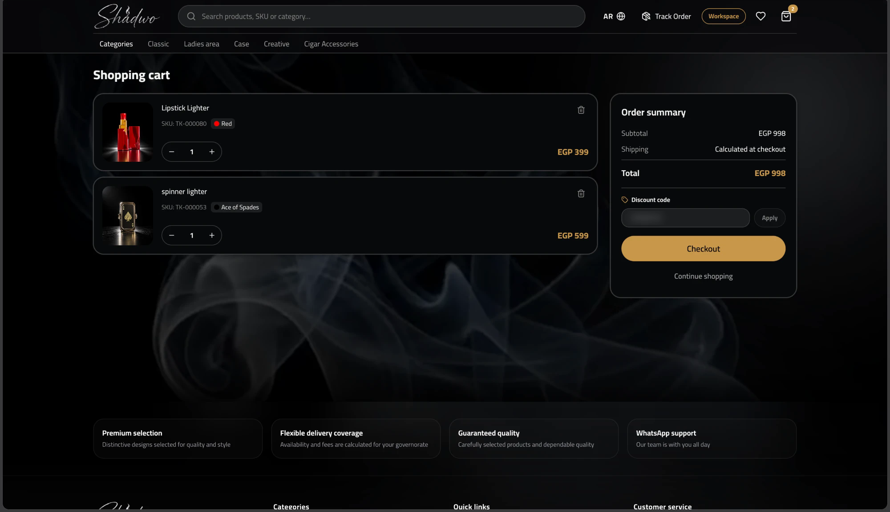
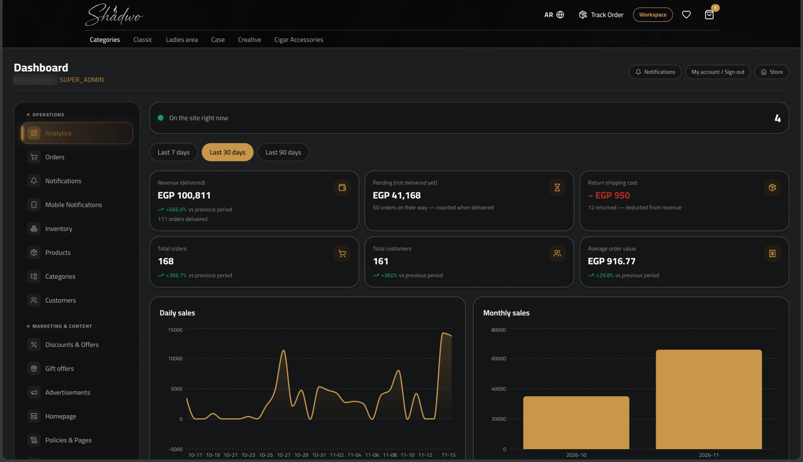
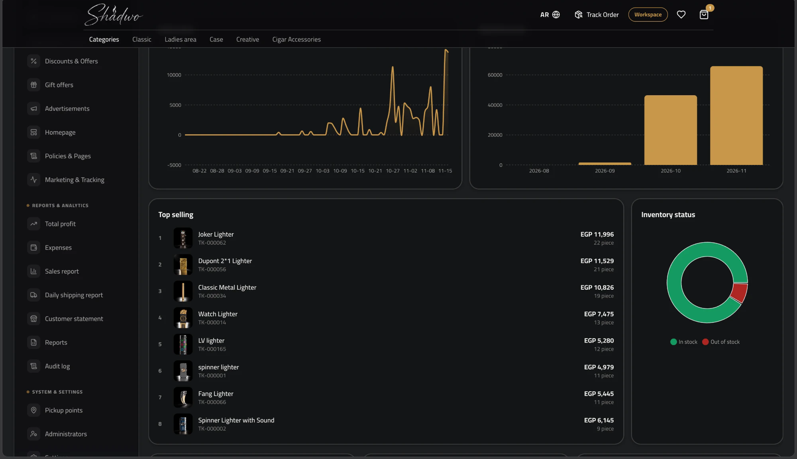

# Shadwo

A bilingual (Arabic / English) multi-vendor e-commerce platform built with Next.js, TypeScript and PostgreSQL. It runs in production as the **Shadwo** online store, and the same codebase includes a full marketplace layer: independent sellers, commissions, settlements and shipping partners.

**Live site:** [shadwo.website](https://shadwo.website)

> The source code is private. This repository is a portfolio showcase: an overview of what the platform does, how it's built, and screenshots from the live site.

---

## Screenshots

### Storefront

Homepage sections managed from the admin panel: "Best deals" with live discount badges, and the shopper's recently viewed products.


| Product page | Cart |
|---|---|
|  |  |
| Image gallery, limited-time offer countdown, stock status and related products. | Variant details (colour, SKU), discount codes and a server-calculated order summary. |

### Admin dashboard

Real figures from the live store over 30 days (Oct 17 – Nov 15, 2026): 168 orders from 161 customers and EGP 100,811 in delivered revenue, with daily and monthly sales charts.



Top-selling products and inventory status, with the full admin navigation (marketing, reports, settings).



---

## What it does

**Storefront**
- Arabic-first UI with full RTL, plus a complete English locale (`/ar`, `/en`)
- Category browsing, search, offers, wishlist, recently viewed products
- Product variants (size / colour), pack sizes and wholesale minimum quantities across variants
- Cart and checkout with server-side pricing, discounts and shipping quotes
- Order tracking and customer account area

**Payments**
- Cash on delivery
- Vodafone Cash / InstaPay transfers with receipt upload and admin verification
- Card payments through Paymob (HMAC-verified callbacks)
- Each method is only offered when it's both enabled and actually configured

**Marketplace**
- Seller onboarding with an approval workflow (draft → review → approved / changes requested)
- Seller portal: products, inventory, orders, earnings, settlements, support
- Commission rates resolved per product → category → seller → platform default
- Seller ledger and periodic settlements, kept separate from order delivery

**Shipping & operations**
- Standard / express / pickup delivery with region coverage rules
- Bosta courier integration (booking + webhooks), plus manual carriers
- Shipping-partner accounts that only see their own shipments
- WhatsApp order confirmations via the Cloud API, with a `wa.me` fallback
- Transactional email through Resend

**Admin dashboard**
- Sales analytics: revenue, orders, AOV, top products, charts
- Products, categories, attributes, inventory adjustments, homepage sections, banners, popups, discounts
- Order management with a validated status state machine, refunds, printable order sheets
- Shipping, finance, profit and marketplace reports with CSV export
- Managers with granular permissions, full audit log, and a launch-readiness page

---

## Tech stack

| Area | Tools |
|---|---|
| Frontend | Next.js 16 (App Router, React Server Components), React 19, TypeScript, Tailwind CSS, Zustand, Recharts |
| Backend | Next.js route handlers, service layer in TypeScript, Zod validation |
| Database | PostgreSQL 16, Prisma ORM (50 models, 26 migrations) |
| Cache / rate limiting | Redis (ioredis) |
| Auth | JWT (`jose`) access + refresh tokens in httpOnly cookies, bcrypt |
| Integrations | Paymob, Bosta, WhatsApp Cloud API, Resend, Cloudinary, GA4, Meta Pixel / Conversions API |
| Testing | Vitest (~100 test files) |
| Infrastructure | Docker, Docker Compose, Caddy (TLS), Linux VPS, GitHub Actions CI |

---

## Architecture

The code is layered so dependencies only point one way: **routes → services → data**.

```
┌──────────────────────────────────────────────────────────────────────┐
│  app/[locale]/...            Pages (server components) + client UI   │
│  app/api/...                 Thin HTTP handlers                      │
├──────────────────────────────────────────────────────────────────────┤
│  API wrappers                Rate limiting, CSRF, auth, RBAC,        │
│                              error mapping, audit logging            │
├──────────────────────────────────────────────────────────────────────┤
│  server/services/            Business logic (orders, sellers,        │
│                              settlements, shipping, reports)         │
│  server/payments/            Payment gateway strategy interface      │
│  server/shipping-providers/  Courier adapters (Bosta)                │
├──────────────────────────────────────────────────────────────────────┤
│  Prisma                      PostgreSQL                              │
└──────────────────────────────────────────────────────────────────────┘
      Redis: cache + rate limits        Disk: media & receipts
```

Deployment is a Docker Compose stack (app, PostgreSQL, Redis) behind Caddy, with persistent volumes for uploads and private payment receipts, plus scheduled database backups.

### User roles

| Role | Access |
|---|---|
| Customer | Storefront, cart, orders, wishlist, account |
| Seller | Own products, orders, earnings and settlements only |
| Shipping | Shipments assigned to their company only |
| Manager | Admin areas granted through individual permissions |
| Super admin | Everything, including managers and store settings |

---

## Technical notes

A few problems that took real thought:

**Money handling.** All prices are stored as integers in minor units (piastres). There's one module for money arithmetic and it's the most heavily tested part of the codebase. The client never calculates totals; it shows what the server returns, so the displayed price and the charged price can't drift apart.

**Not trusting the client.** Shipping cost, discounts, payment availability and wholesale minimums are all checked again inside `placeOrder()`, not just in the UI. A tampered request can't get express shipping at the standard price or skip a minimum quantity.

**Auth and sessions.** Short-lived access tokens with rotating refresh tokens stored hashed in the database. Reusing an old refresh token revokes every session for that user. Changing a manager's permissions revokes their sessions immediately instead of waiting for the token to expire.

**Request security.** Every mutating endpoint goes through a shared wrapper that applies Zod validation, CSRF (double-submit cookie) and Redis-backed rate limiting. In production the login, register, password-reset and upload limits fail closed if Redis is down.

**Seller payouts.** Earning and paying are separate steps. A delivered order makes money *owed* to the seller; a settlement sweeps eligible orders into a payout and writes a ledger entry, so the same order can't be paid twice.

**Payment gateways.** COD, wallet transfer and Paymob all implement one `PaymentGateway` interface, so adding a new provider doesn't touch the checkout flow.

**RTL without duplicate styles.** The whole UI mirrors from the `dir` attribute using logical CSS properties. The English dictionary is type-checked against the Arabic one, so a missing translation fails the build.

**Performance.** Server components by default, ISR on catalogue pages, Redis read-through cache for hot data, narrow Prisma selects, compound indexes and a hard pagination cap.

---

## Team and my role

Shadwo was built by two developers: me and a co-developer. We worked on the same codebase and shared the work across the storefront, admin dashboard, marketplace features and deployment.

---

## Contact

Marwan Mohsen · [GitHub](https://github.com/marwanmohsen221)
